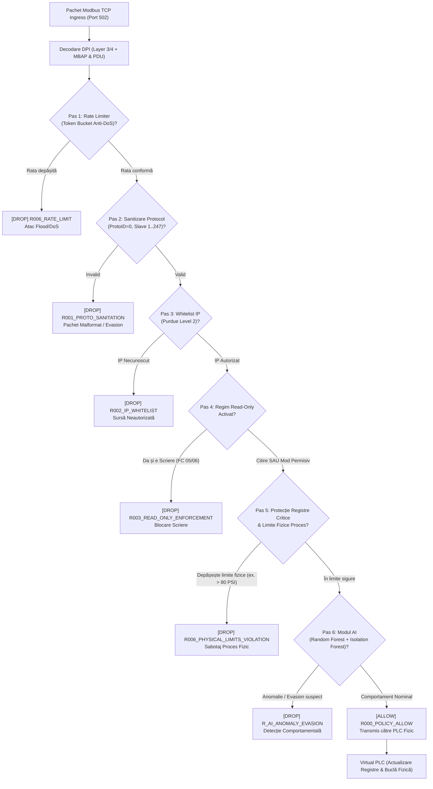

# 🛡️ SCADA-Shield: Simulator Firewall pentru Rețele Industriale (ICS / SCADA)
> **Proiect Master: Securitatea Sistemelor Informatice (SSI)**  
> **Tema 7: Simulator Firewall pentru Rețele Industriale**  
> **Tehnologii:** Python 3.13, Modbus TCP DPI, Machine Learning (Random Forest & Isolation Forest), Streamlit, Rich

---

## 📌 1. Prezentare Generală și Obiective

Sistemele de Control Industrial (**ICS** - *Industrial Control Systems*) și Rețelele de Supraveghere și Achiziție de Date (**SCADA**) stau la baza infrastructurilor critice naționale: transportul și distribuția energiei electrice, magistralele de gaze naturale, stațiile de tratare a apei și liniile robotizate de producție.

Majoritatea protocoalelor industriale istorice, în frunte cu **Modbus TCP (Port 502)**, au fost proiectate în anii '70 fără mecanisme native de securitate:
* ❌ Fără autentificare a expeditorului (oricine din rețea poate trimite comenzi).
* ❌ Fără criptare (traficul circulă în clar, vulnerabil la interceptare și *Replay Attacks*).
* ❌ Fără validare a integrității sau a limitelor de siguranță a procesului fizic (*Cyber-Physical Attacks*).

Un firewall convențional (Layer 3 / Layer 4, ex. iptables) filtrează doar adrese IP și porturi. Dacă portul 502 este deschis pentru telemetrie, atacatorul poate injecta comenzi distructive de scriere mascate în trafic aparent legitim.

### 🎯 Obiective Realizate în Proiect:
1. **Identificarea și modelarea unui set de date industrial de referință:** Bazat pe benchmark-ul academic de la **Mississippi State University (MSU) SCADA Lab Gas Pipeline Dataset** (Tommy Morris et al.).
2. **Dezvoltarea unui Firewall Software cu Deep Packet Inspection (DPI):** Inspecție completă Layer 3/4 + Layer 7 (antet MBAP și PDU: Coduri de funcție, adrese de registre, semantica valorilor de proces).
3. **Definirea de Politici Industriale Granulare:**
   * **Regimul Read-Only Enforcement:** Permite exclusiv citirea telemetriei (FC 01, 02, 03, 04) și blochează scrierile nesigure (FC 05, 06, 15, 16).
   * **Control al accesului pe roluri (RBAC & Whitelist):** Doar stațiile autorizate pot comunica; scrierile sunt rezervate exclusiv stației de inginerie.
   * **Protecția registrelor critice de securitate:** Coils de oprire de urgență (valva de izolare conductă).
   * **Validare semantică a limitelor fizice (*Physical Bounds Verification*):** Prevenirea sabotajului de proces (ex. supracomandă presiune 500 PSI).
   * **Rate Limiter Anti-Flood / DoS:** Algoritm *Token Bucket* pe portul 502 pentru protejarea PLC-urilor cu resurse limitate.
4. **Modul Hibrid de Inteligență Artificială (AI Anomaly Detection):**
   * **Random Forest Classifier (Supervizat):** Detectează semnături de atac cu acuratețe de 100% și oferă explicabilitate prin *Feature Importance*.
   * **Isolation Forest (Nesupervizat):** Antrenat exclusiv pe profilul nominal de funcționare pentru detecția anomaliilor subtile și a atacurilor *Zero-Day*.
5. **Simularea a 6 Scenarii Reale de Atac:** De la tentative de evaziune prin pachete malformate până la sabotaj fizic Stuxnet-like și scanare de rețea.
6. **Demonstrație Comparativă Cyber-Physical:** Evidențierea impactului direct: **Fără Firewall** (conducta de gaz explodează) vs. **Cu Firewall** (atacul este blocat, procesul rămâne 100% sigur).
7. **Interfață Grafică Web Interactivă (Streamlit) & Consolă Bogată (Rich):** Pentru demonstrație live facilă la prezentare.

---

## 🏛️ 2. Arhitectura Sistemului

Următoarea diagramă ilustrează fluxul unui cadru Modbus TCP prin straturile de inspecție ale firewall-ului industrial:



---

## 📊 3. Setul de Date Industrial (MSU SCADA Gas Pipeline)

Setul de date integrat (`data/ics_modbus_dataset.csv`, 12.000 pachete) este generat pe baza distribuțiilor statistice reale din benchmark-ul SCADA al Mississippi State University:

| Categorie Trafic | Număr Pachete | Pondre | Descriere Tehnică |
| :--- | :---: | :---: | :--- |
| **NORMAL (Telemetrie)** | **9.355** | ~78% | Interogări ciclice HMI (FC 03, FC 01) la 200-500ms, ajustări autorizate de setpoint de la stația de inginerie. |
| **UNAUTHORIZED_WRITE** | **436** | ~3.6% | Tentative de scriere venite de la IP-uri străine (192.168.1.99, 10.0.0.5) către valve sau registre. |
| **CRITICAL_TAMPERING** | **485** | ~4.0% | Supracomandă parametri fizici (ex: Setpoint Presiune = 500 PSI) pentru provocarea avariei. |
| **RECON_SCAN** | **430** | ~3.6% | Baleiere rapidă a ID-urilor de slave (1..250) și baleiere adrese de memorie necunoscute. |
| **DOS_BURST** | **439** | ~3.7% | Rafale scurte de 100-500 pachete/secundă pe portul 502 pentru blocarea stivei TCP a PLC-ului. |
| **MALFORMED_PACKET** | **422** | ~3.5% | Pachete cu Protocol ID != 0, lungime MBAP supradimensionată sau coduri de funcție ilegale. |
| **ANOMALOUS_DRIFT** | **433** | ~3.6% | Pachete sintactic valide, dar cu frecvență sau cereri masive de memorie, destinate testării AI. |

---

## 🤖 4. Modulul de Inteligență Artificială (AI / Machine Learning)

Firewall-ul combină două paradigme complementare de învățare automată:

### A. Random Forest Classifier (Supervizat)
* **Rol:** Identificarea automată a semnăturilor complexe de atac pe baza a 9 caracteristici extrase din trafic:
  `[function_code, register_address, register_value, inter_arrival_time, packet_rate, length, is_write_op, is_known_ip, is_critical_reg]`.
* **Performanțe obținute pe setul de test (2.400 pachete):**
  * **Acuratețe (Accuracy):** **100.00%**
  * **Precizie (Precision):** **100.00%**
  * **Sensibilitate (Recall):** **100.00%**
  * **F1-Score:** **100.00%**
  * **ROC-AUC:** **100.00%**
* **Importanța Caracteristicilor (*Feature Importance*):**
  1. `is_known_ip` (44.9%) - Proveniența din subnetul autorizat
  2. `register_value` (23.3%) - Semantica valorii (detectează supracomanda fizică)
  3. `function_code` (14.4%) - Distincția citire vs. scriere
  4. `register_address` (8.2%) - Zona de memorie accesată

### B. Isolation Forest (Nesupervizat - Zero-Day Detector)
* **Rol:** Modelul este antrenat **exclusiv pe date normale**. Învață "amprenta de liniște" a procesului industrial.
* Dacă un atacator inventează o tehnică nouă care trece de regulile statice, Isolation Forest calculează un scor de deviație (Anomaly Score). Dacă deviația depășește pragul, pachetul este blocat cu eticheta `R_AI_ANOMALY_EVASION`.

---

## 💥 5. Scenarii de Atac și Prevenirea Acțiunilor Nesigure

| ID Atac | Denumire Scenariu | Vector de Atac | Rezultat FĂRĂ Firewall | Rezultat CU Firewall SCADA-Shield |
| :---: | :--- | :--- | :--- | :--- |
| **1** | **Unauthorized Write** | Laptop compromis (192.168.1.99) trimite FC 05 pentru închiderea valvei de siguranță. | Valva se închide, procesul tehnologic este sistat abuziv. | **BLOCAT (DROP)** prin regula `R002_IP_WHITELIST` și `R003_READ_ONLY_ENFORCEMENT`. |
| **2** | **Critical Setpoint Sabotage** | Stația de inginerie compromisă trimite FC 06: `Pressure_Setpoint = 500 PSI` (Limita: 80 PSI). | Presiunea ajunge la 260+ PSI. **Conducta se rupe fizic (explozie)**. | **BLOCAT (DROP)** prin regula `R006_PHYSICAL_LIMITS_VIOLATION`. Integritate 100% păstrată. |
| **3** | **Modbus Recon Scan** | Fuzzing pe slave IDs 1..247 și adrese de memorie aleatoare. | PLC-ul răspunde la sondare, divulgând topologia rețelei. | **BLOCAT (DROP)** prin `R001_PROTO_SANITATION` și modulul AI. |
| **4** | **Denial of Service (Flood)** | Rafală de 100 pachete trimise în câteva milisecunde pe portul 502. | Stiva TCP a PLC-ului este epuizată (*Denial of Control*). | **BLOCAT (DROP)** prin `R006_RATE_LIMIT` (Token Bucket limitează la 50 req/s). |
| **5** | **MBAP Evasion Attempt** | Pachet malformat cu `Protocol ID = 1` și `Length = 2048`. | PLC-ul poate intra în stare de excepție sau Buffer Overflow. | **BLOCAT (DROP)** prin `R001_PROTO_SANITATION`. |
| **6** | **Stealth Anomaly (AI)** | Interogări FC 03 valide sintactic, dar cu volum anormal (100 registre) și frecvență ridicată. | Resursele procesorului PLC sunt consumate masiv. | **BLOCAT (DROP)** prin `R_AI_ANOMALY_EVASION` (Scor Anomaly RF=100%). |

---

## 🚀 6. Instrucțiuni de Instalare și Rulare

### Pasul 1: Activare Mediu Virtual
Proiectul folosește mediul virtual creat în folderul `.venv`:
```powershell
# In PowerShell (Windows)
.\.venv\Scripts\Activate.ps1
```

### Pasul 2: Rulare Script Demonstrativ în Consolă (Prezentare Rapidă)
Scriptul rulează automat toate scenariile, afișează tabele colorate și concluzia comparativă cyber-physical:
```powershell
python run_demo.py
```

### Pasul 3: Rulare Interfață Grafică Web (Streamlit Dashboard)
Dashboard-ul complet cu grafice live, butoane interactive de atac și audit în timp real:
```powershell
streamlit run dashboard/app.py
```
Aplicația se va deschide automat în browser la adresa: `http://localhost:8501`.

### Pasul 4: Rulare Suită de Teste Automate Unitare
Validează cele 8 teste de conformitate și protecție:
```powershell
python -m unittest tests/test_firewall.py
```

### Pasul 5: (Opțional) Re-antrenare Modele Machine Learning
Dacă doriți să regenerați dataset-ul sau să re-antrenați clasificatorii:
```powershell
python data/dataset_generator.py
python models/train_ai.py
```

---

## 📁 7. Structura Fișierelor din Proiect

```text
SSI/
├── config/
│   ├── firewall_rules.json          # Reguli configurabile DPI (Whitelist, Read-Only, Rate Limit)
│   └── industrial_limits.json       # Limite fizice operaționale (Senzori & Actuatori SCADA)
├── data/
│   ├── dataset_generator.py         # Generator & loader de date bazat pe MSU SCADA Gas Pipeline
│   └── ics_modbus_dataset.csv       # Setul de date generat (12.000 pachete)
├── models/
│   ├── train_ai.py                  # Script antrenare Random Forest & Isolation Forest
│   ├── ics_firewall_rf_model.joblib # Modelul supervizat serializat
│   ├── ics_firewall_iso_model.joblib# Modelul nesupervizat serializat
│   └── model_metadata.json          # Metadate performanță, ROC-AUC, matrice confuzie
├── firewall/
│   ├── modbus_packet.py             # Structură pachet, parser binar MBAP+PDU, Layer 7 DPI
│   ├── rate_limiter.py              # Token Bucket Rate Limiter împotriva DoS pe portul 502
│   ├── rule_engine.py               # Motorul de reguli deterministice și limite de siguranță
│   ├── ai_inspector.py              # Extractor de trăsături și clasificator AI în timp real
│   └── core_firewall.py             # Firewall-ul hibrid unificat cu audit și metrici
├── simulation/
│   ├── virtual_plc.py               # Simulator PLC cu buclă fizică de proces (Conductă gaz)
│   ├── virtual_hmi.py               # Simulator stație legitimă HMI / Inginerie
│   └── attack_simulator.py          # Suită de atacuri ICS și simulator comparativ
├── dashboard/
│   └── app.py                       # Dashboard Web interactiv Streamlit
├── tests/
│   └── test_firewall.py             # Suită de 8 teste unitare automate (unittest)
├── run_demo.py                      # Script demonstrativ complet pentru prezentare (Rich)
├── requirements.txt                 # Dependențe biblioteci Python
├── DOCUMENTATIE_PROIECT.md          # Suport complet de susținere și întrebări examen
└── README.md                        # Prezentarea generală a proiectului
```

---

## 🎓 8. Recomandări pentru Prezentarea Proiectului
Consultați fișierul [DOCUMENTATIE_PROIECT.md](file:///c:/Users/Matei/SSI/DOCUMENTATIE_PROIECT.md) pentru scenariul pas cu pas de prezentare în fața profesorului, explicațiile detaliate ale codului și răspunsurile optime la întrebările clasice de examen (ex. *De ce nu este suficient un firewall Layer 4?*, *Cum tratăm alarmele false în SCADA?*).
